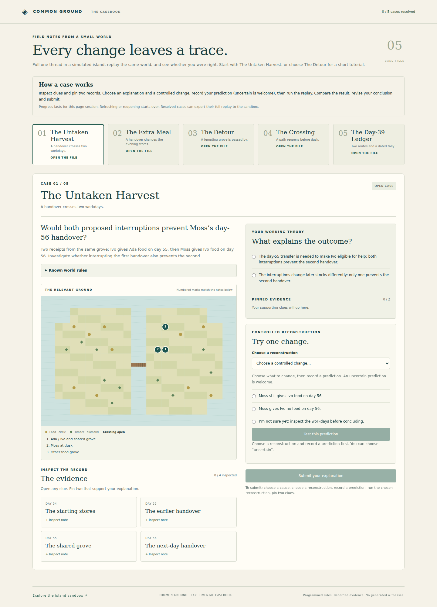

# Common Ground

**Pull one thread in a simulated island, replay the same world, and see whether you were right.**

Common Ground is a small experimental casebook about cause and effect. Its residents forage, share food, exchange observations and repair a crossing. Every clue and experiment comes from the programmed simulation. Choose an explanation, change one factor, and inspect the resulting history.



## Play

Download `casebook-standalone.html` and open it in a modern browser. For the sandbox and export workflow, also download `standalone.html` into the same folder. It works offline, with no installation, account or model calls. A static host can serve `index.html`, which is the same casebook.

Start with **The Untaken Harvest**: two ways of interrupting the same handover have different later consequences. For a shorter tutorial, choose **The Detour**.

1. Open the clues and pin two supporting records.
2. Choose an explanation, an experiment and a prediction. Uncertainty is welcome.
3. Run the replay, compare the evidence, revise your conclusion and submit.

Progress lasts for the current page session; refreshing starts over. After resolution, export the selected starting comparison and open it in `standalone.html`, the island sandbox, to inspect the full histories. A dated export may ask you to advance to its measurement day.

## Five investigations

| Case | What you investigate |
| --- | --- |
| The Untaken Harvest | Whether preventing one transfer is enough to explain a later handover. |
| The Extra Meal | Whether remembered help changes a particular gift's timing. It shares the Harvest case's starting checkpoint. |
| The Detour | How dated information changes a route and its immediate harvest. A short tutorial. |
| The Crossing | Who can deliver the missing timber within one workday. |
| The Day-39 Ledger | Whether a food-stock ranking survives a later measurement. A guided timing lesson. |

The casebook offers fifteen experiments or measurements. Its hypotheses are guided choices, rather than an open detective world. Solutions are present in the client source for grading; ordinary play hides them until resolution.

## How the evidence works

Comparisons begin from the same physical checkpoint. The selected intervention can change later decisions, routes and stocks. Random draws are keyed by seed, day, resident and purpose, so taking a different branch does not shift every subsequent random call. Recorded receipts and resource ledgers account for food and timber. The interface distinguishes before-choice snapshots from end-of-day measurements.

These residents follow simple programmed rules, not realistic human psychology or autonomous language models. Sharing is not guaranteed, and removing a starting help association does not prohibit later gifts. Local observations and reports use dated stock forecasts; the route scorer does not optimize future arrival stocks. Communication is free. A result at one date is not a permanent welfare or information-benefit claim.

Some dramatic results during development disappeared when routing and observation rules were corrected. The playable cases retain the smaller effects that survived those checks. Enjoyment, commercial demand and global novelty have not been established.

## Build and test

Requires Node.js 18 or later for the build and JavaScript tests. There are no npm dependencies to install.

```sh
npm run build
npm test
```

The build produces `standalone.html` from `sandbox.html`, and `casebook-standalone.html` from `casebook.html`; it also copies the casebook to `index.html`. Generated files are included so visitors can play without building.

An optional Python 3 local preview serves an explicit asset list on loopback:

```sh
python3 server.py
```

Open `http://127.0.0.1:8765/`. To test the preview boundary:

```sh
python3 -B -m unittest discover -s tests -p 'test_*.py'
```

The standalone files include a Content Security Policy that blocks network connections. A host must supply response headers for framing restrictions and `X-Content-Type-Options`; those cannot be fully provided by a page's meta policy. Nothing here requires a running backend.

See [ENGINE_API.md](ENGINE_API.md) for simulation controls and [MYSTERY_API.md](MYSTERY_API.md) for case data and grading. [DEMO.md](DEMO.md) walks through a sandbox comparison and contains spoilers for The Detour.

## License and provenance

MIT; see [LICENSE](LICENSE). The included code, case text and canvas/CSS visuals were developed for this project with model assistance. The player has no third-party runtime assets, remote fonts, external services or API keys. Tests use Node's built-in runner. The exploratory case-discovery tools and private operating material are outside this release.
